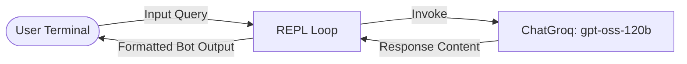
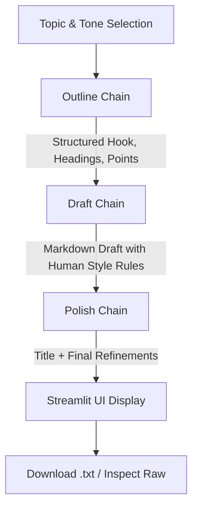
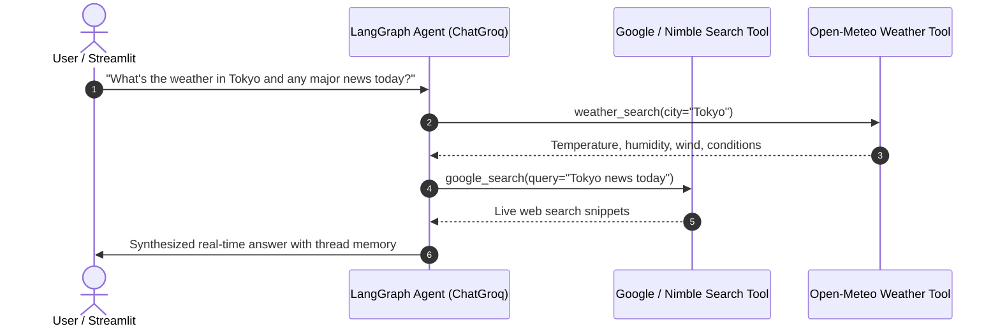
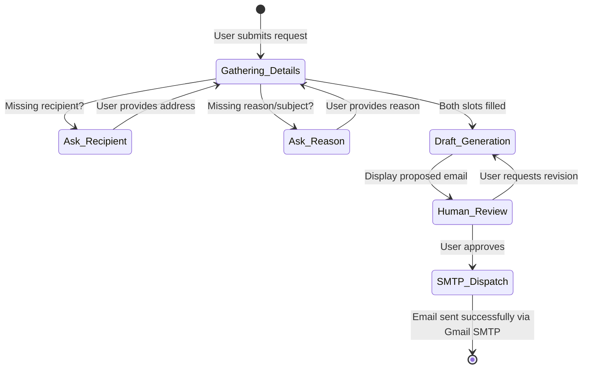

# LangChain Projects: Architecture, Capabilities & Implementation Guide

An end-to-end technical overview of the LangChain ecosystem built within this repository, demonstrating the evolution from foundational LLM prompts to multi-stage LangChain Expression Language (LCEL) chains and autonomous, memory-backed LangGraph agents with real-world tool execution.

---

## 1. Executive Summary & Vision

The goal of this repository is to demonstrate practical, production-grade patterns for building with Large Language Models using **LangChain**, **LangGraph**, and ultra-low-latency **Groq LPU** inference.

Rather than toy scripts, the projects represent four distinct stages of AI application maturity:

```
[00_qna_bot]               --> [01_blog_generator]             --> [02_Project_Search_weather_agent] --> [03_Email_Agent]
Direct LLM Interface           Multi-Stage LCEL Pipeline           Tool-Calling Autonomous Agent          Action Agent with HITL
Low-latency conversational      Prompt chaining, anti-cliché        Dynamic routing, real-time web &       Slot filling, approval gate,
query & response loops          style rules, Streamlit UI           weather API integration                SMTP email dispatch
```

---

## 2. Core Architectural Pillars

### A. High-Throughput Inference with Groq
All projects use `ChatGroq` (`openai/gpt-oss-120b`, `openai/gpt-oss-20b`, or configurable models via environment variables), achieving near-instantaneous token generation and enabling fluid interactive experiences in both CLI and Streamlit interfaces.

### B. Declarative Pipelines with LCEL
Project `01_blog_generator` uses the LangChain Expression Language pipe syntax (`Prompt | LLM | StrOutputParser()`), providing declarative, deterministic, and easily composable workflows without legacy chain boilerplate.

### C. Stateful Checkpointing via LangGraph
Projects `02` and `03` leverage `InMemorySaver` from `langgraph.checkpoint.memory` combined with `create_agent`. This equips the agents with thread-isolated, multi-turn conversational memory (`thread_id="chat_1"`), allowing them to remember previous user context, parameters, and intermediate steps.

### D. Zero-Leak Security Architecture
All sensitive API keys (`GROQ_API_KEY`, `WEATHER_API_KEY`, `SMTP_PASSWORD`, `VOYAGE_API_KEY`) are isolated in local `.env` files and tracked safely via `.gitignore` and `.env.example`.

---

## 3. Project-by-Project Deep Dive

---

### Project 00: Interactive Q&A Bot (`00_qna_bot`)

#### The Idea
A fast, lightweight, and resilient conversational terminal interface for interacting with high-capability open models hosted on Groq LPUs.

#### How It Works
1. Loads environment variables dynamically using `find_dotenv()`.
2. Initializes `ChatGroq(model="openai/gpt-oss-120b")`.
3. Runs a continuous read-eval-print loop (REPL) processing standard text queries.
4. Strips empty queries and responds in real-time.



#### Key Abilities
- **Instant Response Times**: Groq LPU execution provides instant answers.
- **Graceful Termination**: Responds to exit keywords (`exit`) and ignores blank inputs.
- **Directory Agnostic**: Automatically resolves `.env` from root or subfolders.

---

### Project 01: AI Blog Post Generator (`01_blog_generator`)

#### The Idea
LLMs often produce generic, formulaic text when asked to write articles in a single prompt. This project breaks generation into a **three-stage LCEL chain** (Outline $\rightarrow$ Draft $\rightarrow$ Polish) guided by strict **anti-AI cliché rules** (`HUMAN_STYLE`) to produce authentic, human-sounding content.

#### How It Works



1. **Stage 1 (Outline)**: Produces an attention-grabbing opening line, 4 section headings, and 5 key points.
2. **Stage 2 (Draft)**: Expands the outline into structured Markdown while enforcing conversational tone, short/long sentence cadence, and banning overused AI buzzwords (*"delve"*, *"in today's fast-paced world"*, *"testament"*, *"robust"*).
3. **Stage 3 (Polish)**: Tightens phrasing, prepends a compelling `#` title, and formats final Markdown.

#### Key Abilities
- **Pipeline Segregation**: Each stage has an isolated prompt and responsibility.
- **Streamlit Web Application**: Interactive UI with real-time spinners (`st.spinner`) informing the user of pipeline stage transitions.
- **Export Capabilities**: Direct one-click download (`st.download_button`) and collapsible raw inspection (`st.expander`).

---

### Project 02: Real-Time Search & Weather Agent (`02_Project_Search_weather _agent`)

#### The Idea
LLMs have a knowledge cutoff and cannot observe live environmental or web data. This project builds a ReAct-style autonomous agent that reasons about user intent and dynamically chooses between real-time web search and live meteorological feeds.

#### How It Works



1. **Agent Setup**: Uses `create_agent` with Groq and an `InMemorySaver` checkpointer.
2. **Geocoding & Forecast Integration**:
   - `weather_search` uses Open-Meteo’s free API: geocodes the city name to latitude/longitude, queries live weather conditions, maps WMO weather codes to human-readable strings, and formats degrees/humidity/wind.
   - Alternate tool available for OpenWeatherMap via API keys.
3. **Web Search**:
   - `google_search` handles live internet queries via deep search parsers (`NimbleSearchTool`).

#### Key Abilities
- **Zero-Key Weather Option**: Uses open meteorological endpoints without external API key barriers.
- **Multi-Turn Thread Persistence**: The Streamlit interface preserves state across turns via `{"configurable": {"thread_id": "chat_1"}}`.
- **Autonomous Tool Selection**: The agent evaluates whether a query requires web search, weather lookups, both, or direct knowledge.

---

### Project 03: Action Email Agent (`03_Email_Agent`)

#### The Idea
AI agents that perform write-actions in the physical world (such as sending emails) require safeguards. This project implements a **Human-in-the-Loop (HITL)** email agent that collects necessary parameters, drafts the email, and executes dispatch via Gmail SMTP.

#### How It Works



1. **Slot Filling Rules**: The agent strictly requests missing fields (recipient email and email reason) without guessing.
2. **Draft & Approval Guardrail**: Before dispatching, the agent displays the draft to the user for feedback or approval.
3. **SMTP Engine**: Connects to `smtp.gmail.com` on port `587` over secure TLS using app passwords to send plain-text `MIMEMultipart` messages.

#### Key Abilities
- **Safe Execution**: Strict instructions against sending unauthorized or unconfirmed messages.
- **Stateful Memory**: Maintains context across multiple conversational turns using LangGraph checkpointing.
- **Secure Credentials**: Uses environment-injected Google App Passwords (`SMTP_PASSWORD`).

---

## 4. Architecture Comparison Matrix

| Feature / Dimension | `00_qna_bot` | `01_blog_generator` | `02_Search_weather_agent` | `03_Email_Agent` |
| :--- | :--- | :--- | :--- | :--- |
| **Primary Pattern** | Direct Invocation | LCEL Pipeline Chaining | ReAct Autonomous Agent | Action Agent with Slot Filling |
| **Interface** | Terminal CLI | Streamlit Web App | Streamlit Chat Interface | Streamlit Chat Interface |
| **State & Memory** | Stateless REPL | Session State | `InMemorySaver` Checkpointer | `InMemorySaver` Checkpointer |
| **Tools Utilized** | None | None (Pure Prompts) | Open-Meteo, Google Search | Gmail SMTP (`smtplib`) |
| **Model Backend** | Groq LPU | Groq LPU | Groq LPU | Groq LPU |
| **Output Type** | Text Stream | Polished Markdown & File | Conversational Synthesis | Real-world Email Dispatch |

---

## 5. Technology Stack & Dependencies

- **Language**: Python 3.10+ (tested on Python 3.12)
- **Core Orchestration**: `langchain`, `langchain-core`, `langchain-community`, `langgraph`
- **Model Providers**: `langchain-groq` (Groq API)
- **Web Frontend**: `streamlit`
- **Environment & Configuration**: `python-dotenv`
- **External APIs**: Open-Meteo REST API, Gmail SMTP, OpenWeatherMap

---

## 6. How to Run Each Project

Ensure you have your virtual environment activated and dependencies installed:

```powershell
# Activate environment
.\.venv\Scripts\activate

# Install requirements
pip install -r requirements.txt
```

### Running Project 00 (Terminal Q&A Bot)
```powershell
python Projects/00_qna_bot/app.py
```

### Running Project 01 (Blog Post Generator Web App)
```powershell
streamlit run Projects/01_blog_generator/app.py
```

### Running Project 02 (Search & Weather Agent Web App)
```powershell
cd "Projects/02_Project_Search_weather _agent"
streamlit run app.py
```

### Running Project 03 (Email Assistant Web App)
```powershell
cd "Projects/03_Email_Agent"
streamlit run app.py
```

---

## 7. Security Best Practices

1. **Keep Secrets Out of Version Control**:
   - Never commit `.env` or hardcode credentials in source code.
   - Use `.env.example` to document required environment variables.
2. **Gmail App Passwords**:
   - Never use your primary Google account password for SMTP. Generate a dedicated 16-character **Google App Password** with 2-Factor Authentication enabled.
3. **Agent Scope Constraints**:
   - Limit tool permissions and include explicit guardrails in system prompts to prevent unintended tool invocation.
