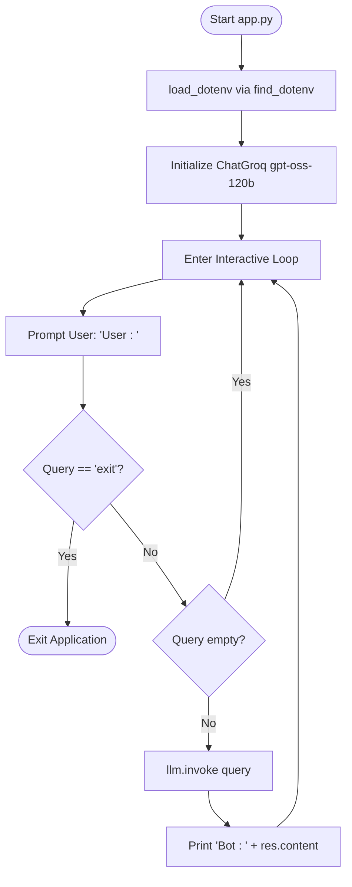

# Project 00: Interactive Terminal Q&A Bot

A fast, lightweight, and resilient conversational terminal interface powered by **LangChain** and **Groq LPU** inference (`openai/gpt-oss-120b`).

---

## 1. The Core Idea

Large Language Model interfaces often become weighed down by complex web servers or heavy frameworks when all that is needed is a lightning-fast, zero-friction dialogue loop. 

**`00_qna_bot`** demonstrates the minimal yet production-ready pattern for direct model invocation:
- Near-zero latency using Groq's specialized inference hardware.
- Resilient environment variable resolution that works regardless of where the script is executed.
- Clean REPL (Read-Eval-Print Loop) terminal interaction.

---

## 2. How It Works



1. **Environment Initialization**: Uses `find_dotenv()` to locate the root `.env` file even when executed from deep subdirectories.
2. **Model Instantiation**: Spawns a `ChatGroq` instance configured with the high-parameter `openai/gpt-oss-120b` open model.
3. **Execution Loop**: Captures terminal input, filters empty inputs, checks for the `exit` command, invokes the model with the query string, and outputs the result.

---

## 3. Main Capabilities & Abilities

- **Sub-Second Token Generation**: Leverages Groq LPUs for rapid, fluid conversational answers.
- **Robust Exception Prevention**: Accepts sanitized string prompts preventing LangChain dictionary type validation errors.
- **Directory Agnostic**: Can be run from the repository root or directly inside `Projects/00_qna_bot/`.

---

## 4. File Structure

```
00_qna_bot/
├── app.py          # Main REPL execution script
└── README.md       # Project documentation
```

---

## 5. Setup & How to Run

### Prerequisites
Make sure your virtual environment is active and `GROQ_API_KEY` is defined in `.env`:
```env
GROQ_API_KEY=gsk_your_groq_api_key_here
```

### Running the Bot
From anywhere in the repository:
```powershell
# From repo root
python Projects/00_qna_bot/app.py

# Or from this directory
cd Projects/00_qna_bot
python app.py
```

### Example Session
```text
Q&A Bot initialized! Type 'exit' to quit.

User : What is the core difference between a Chain and an Agent in LangChain?
Bot  : In LangChain:
       - A Chain is a hardcoded, deterministic sequence of steps (A -> B -> C).
       - An Agent uses an LLM as a reasoning engine to dynamically decide which tools to call and in what order.

User : exit
```
