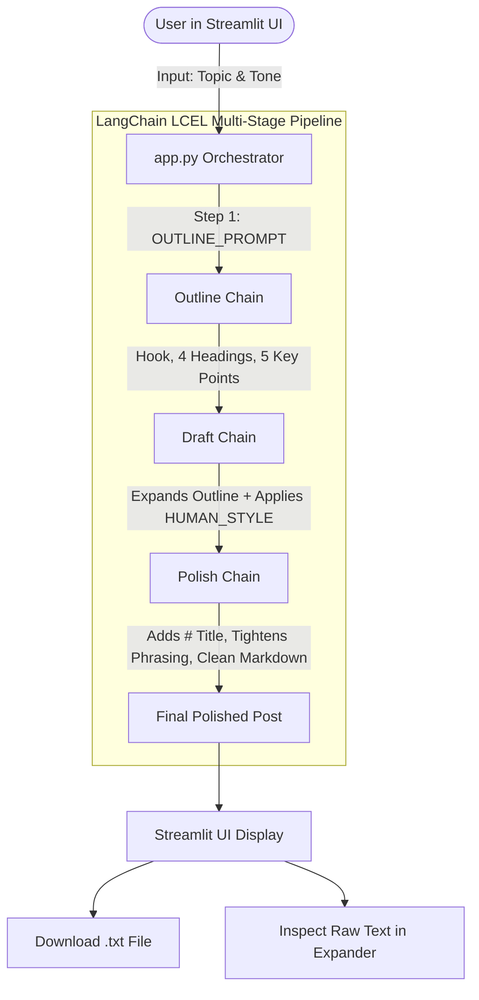

# Project 01: AI Blog Post Generator

A multi-stage content generation pipeline using **LangChain Expression Language (LCEL)** and **Streamlit**, designed to eliminate generic, robotic AI writing through strict stylistic guardrails.

---

## 1. The Core Idea

When prompted to "write a blog post", LLMs typically generate repetitive, buzzword-heavy content filled with clichés (*"in today's fast-paced world"*, *"delve into"*, *"it's worth noting"*).

**`01_blog_generator`** solves this through two architectural decisions:
1. **Pipeline Decomposition**: Splitting generation into three distinct stages (**Outline $\rightarrow$ Draft $\rightarrow$ Polish**), where each stage has a single, focused responsibility.
2. **Negative Prompt Styling (`HUMAN_STYLE`)**: A strict ruleset explicitly banning overused AI vocabulary, forcing short-to-long sentence variance, conversational contractions, and concrete examples.

---

## 2. How It Works



### The Three Chains
1. **Outline Chain**:
   ```python
   outline_chain = OUTLINE_PROMPT | llm | StrOutputParser()
   ```
   Generates an opening hook that provokes curiosity, 4 clear headings, and 5 mandatory talking points.
2. **Draft Chain**:
   ```python
   draft_chain = DRAFT_PROMPT | llm | StrOutputParser()
   ```
   Converts the outline into full paragraphs while enforcing the `HUMAN_STYLE` rules.
3. **Polish Chain**:
   ```python
   final_chain = POLISH_PROMPT | llm | StrOutputParser()
   ```
   Refines phrasing without altering meaning, formats clean Markdown, and adds a compelling title.

---

## 3. Main Capabilities & Abilities

- **Anti-AI Stylistic Guardrails**: Banned phrase lists and sentence length variation produce text indistinguishable from human writing.
- **Interactive UI with Progress Indicators**: Step-by-step visual feedback using `st.spinner("Generating outline...")`, `st.spinner("Drafting...")`, and `st.spinner("Polishing...")`.
- **Export & Inspection**: Direct `.txt` file downloads and a collapsible code inspection block.
- **Tone Flexibility**: Allows selecting tones such as *Informative*, *Persuasive*, *Entertaining*, *Formal*, and *Casual*.

---

## 4. File Structure

```
01_blog_generator/
├── app.py                       # Streamlit web application & LCEL chain definition
├── README.md                    # Project documentation
└── Screenshot 2026-11-26.png    # UI preview screenshot
```

---

## 5. Setup & How to Run

### Prerequisites
Make sure dependencies are installed and `GROQ_API_KEY` is present in your `.env` file:
```env
GROQ_API_KEY=gsk_your_groq_api_key_here
```

### Running the Web Application
```powershell
# From repo root
streamlit run Projects/01_blog_generator/app.py

# Or from this directory
cd Projects/01_blog_generator
streamlit run app.py
```

The browser will open at `http://localhost:8501`. Enter your topic, select your tone, and click **Generate Blog Post**.
