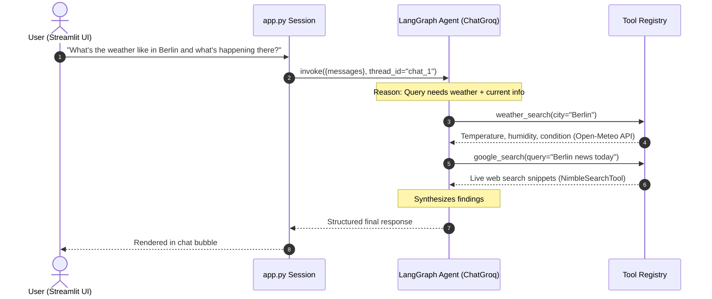

# Project 02: Real-Time Search & Weather Agent

An autonomous research and meteorological assistant built with **LangChain Agents**, **LangGraph Memory Checkpointing**, and **Streamlit**.

---

## 1. The Core Idea

Static LLMs are limited by static training data and knowledge cutoffs. They cannot tell you today's weather or verify news that broke an hour ago.

**`02_Project_Search_weather _agent`** demonstrates how to build an autonomous agent that:
- Acts as a reasoning engine, deciding when external data is needed.
- Calls real-time tools (**Google Search** and **Open-Meteo Weather**) dynamically.
- Maintains multi-turn conversation memory using LangGraph's `InMemorySaver` checkpointer.

---

## 2. How It Works



### Core Components
1. **Tool Definitions (`tools_modern.py` & `tools.py`)**:
   - `weather_search`: Performs geocoding on the requested city, queries the Open-Meteo REST API, maps numeric WMO weather codes to plain English descriptions, and returns structured meteorological data. Requires **no API key**.
   - `google_search`: Connects to `NimbleSearchTool` for live web search and information retrieval.
2. **Autonomous Agent (`agent.py`)**:
   - Built with `create_agent(model, tools, system_prompt, checkpointer)`.
   - Uses `InMemorySaver()` so that follow-up questions (e.g. *"What about tomorrow?"* or *"And what clothes should I pack for that?"*) retain the context of previous messages.
3. **Streamlit Chat Interface (`app.py`)**:
   - Manages state via `st.session_state.messages` and `st.session_state.agent`.
   - Handles streaming conversation through `st.chat_message` and `st.chat_input`.

---

## 3. Main Capabilities & Abilities

- **Zero-Key Weather Lookups**: Real-time worldwide weather without needing third-party paid accounts or rate-limited API keys.
- **Autonomous Tool Routing**: The model independently determines whether to invoke one tool, multiple tools, or answer directly.
- **Stateful Conversational Threads**: Keeps context intact across multiple turns using thread identifiers (`thread_id="chat_1"`).
- **Clean Chat Interface**: Full conversational UI with user and assistant message history.

---

## 4. File Structure

```
02_Project_Search_weather _agent/
├── agent.py            # Agent factory & checkpointer configuration
├── app.py              # Streamlit chat user interface
├── tools_modern.py     # Production-grade Open-Meteo weather & search tools
├── tools.py            # Alternative OpenWeatherMap & Nimble search tools
└── README.md           # Project documentation
```

---

## 5. Setup & How to Run

### Prerequisites
Configure your `.env` file in the root directory:
```env
GROQ_API_KEY=gsk_your_groq_api_key_here
MODEL="openai/gpt-oss-20b"
```

### Running the Agent
```powershell
# From repo root
streamlit run "Projects/02_Project_Search_weather _agent/app.py"

# Or from this directory
cd "Projects/02_Project_Search_weather _agent"
streamlit run app.py
```

Open `http://localhost:8501` to chat with the agent.
