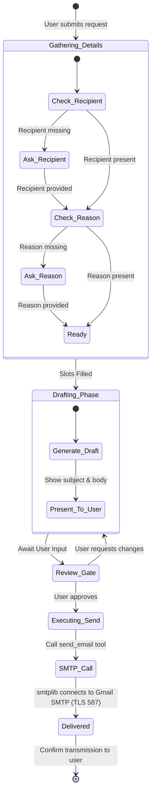

# Project 03: Autonomous Action Email Agent (with Human-in-the-Loop)

An automated action agent built with **LangChain**, **LangGraph Checkpointing**, and **Gmail SMTP**, featuring strict **Human-in-the-Loop (HITL)** safeguards for secure email dispatch.

---

## 1. The Core Idea

Allowing an AI model to take actions in the real world—such as sending emails—carries significant risks: hallucinated recipient addresses, unwanted emails sent prematurely, or inaccurate drafts.

**`03_Email_Agent`** implements a safe, production-style action workflow:
- **Slot Filling**: The agent refuses to guess. It systematically gathers missing data (recipient email and core topic).
- **Human-in-the-Loop (HITL) Gate**: It drafts the message and waits for user confirmation before calling the dispatch tool.
- **Direct SMTP Dispatch**: Once approved, sends the email directly through Gmail’s secure SMTP servers over TLS.

---

## 2. How It Works



### Key Workflow Rules (Enforced in `SYSTEM_PROMPT`)
1. **Never guess or hallucinate**: If either the recipient address or the email purpose is missing, the agent asks for one piece of information at a time in a concise sentence.
2. **Draft before dispatch**: Displays the draft subject and body to the user.
3. **Execution only on approval**: Invokes `send_email` only when the user explicitly greenlights the send action.
4. **Context preservation**: Uses LangGraph's `InMemorySaver` checkpointer so previous answers and addresses aren't forgotten.

---

## 3. Main Capabilities & Abilities

- **Human-in-the-Loop Safeguards**: Prevents unauthorized or premature message transmission.
- **Gmail SMTP Integration**: Connects to `smtp.gmail.com` on port `587` with STARTTLS encryption.
- **Multi-Turn Memory**: Uses thread checkpointing (`thread_id="chat_1"`) to maintain continuity throughout the drafting and revision process.
- **Streamlit Chat UI**: An interactive chat interface for conversation, drafting, review, and status tracking.

---

## 4. File Structure

```
03_Email_Agent/
├── agent.py            # Agent definition, system prompt & checkpointer
├── app.py              # Streamlit chat interface
├── tool.py             # Gmail SMTP connection & LangChain tool definition
└── README.md           # Project documentation
```

---

## 5. Setup & How to Run

### Step 1: Configure Gmail App Password
Gmail requires a dedicated **App Password** when sending emails through SMTP:
1. Go to your [Google Account Security Settings](https://myaccount.google.com/security).
2. Enable **2-Step Verification**.
3. Search for **App passwords** and generate a password for *"Mail"*.
4. Copy the 16-character generated code.

### Step 2: Configure Environment Variables
In your root `.env` file, add:
```env
GROQ_API_KEY=gsk_your_groq_api_key_here
MODEL="openai/gpt-oss-20b"
SMTP_SENDER_EMAIL=your_email@gmail.com
SMTP_PASSWORD=your_16_character_app_password
```

### Step 3: Run the Agent
```powershell
# From repo root
streamlit run "Projects/03_Email_Agent/app.py"

# Or from this directory
cd "Projects/03_Email_Agent"
streamlit run app.py
```

Open `http://localhost:8501` to start interacting with the email agent.
